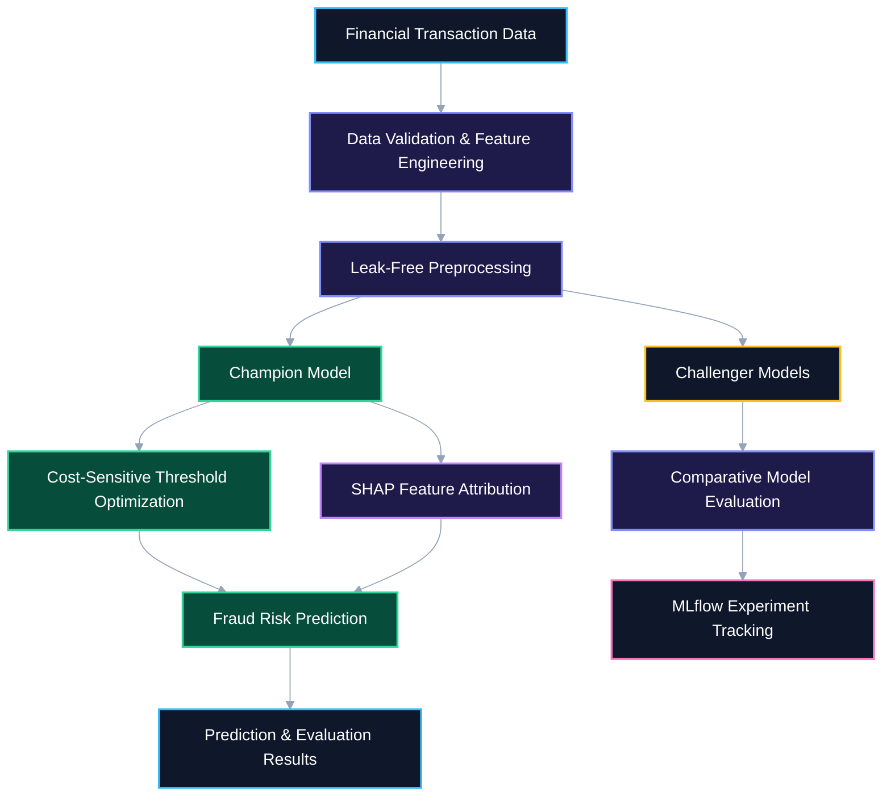

# 🕵️ FraudLens — Cost-Aware Financial Fraud Detection & MLOps

<div align="center">

  

  <br/><br/>

  <a href="https://fraudlens-7qbkui3wexmjpsmp8z7pm8.streamlit.app/" target="_blank">
    
  </a>

  <br/><br/>

  
  
  
  
  
  

</div>

---

## 🌐 Live Interactive Deployment

Explore FraudLens directly in your browser.

**[🚀 Launch FraudLens Live Platform](https://fraudlens-7qbkui3wexmjpsmp8z7pm8.streamlit.app/)**

FraudLens focuses on financial fraud detection, cost-sensitive classification, interpretable predictions, and model evaluation.

---

## 📌 Overview

**FraudLens** is a cost-aware machine learning and MLOps project designed to detect potentially fraudulent financial transactions in highly imbalanced datasets.

Instead of relying solely on accuracy, FraudLens combines precision-recall evaluation, business cost-sensitive threshold optimization, explainable predictions, and Champion-versus-Challenger model evaluation.

The project demonstrates how machine learning can support financial risk analysis through reproducible experiments, transparent evaluation, and interpretable predictions.

### 🎯 Project Objectives

- Detect potentially fraudulent transactions under severe class imbalance.
- Compare classification models using appropriate evaluation metrics.
- Optimize decision thresholds based on the financial cost of classification errors.
- Explain individual predictions using SHAP feature attributions.
- Evaluate challenger models against a preferred champion model.
- Track experiment parameters, metrics, and artifacts using MLflow.
- Support reproducible training, testing, and evaluation workflows.

---

## 🏗️ End-to-End Pipeline & Architecture

<div align="center">
  
</div>

### System Architecture



The pipeline separates data preparation, model training, threshold selection, explainability, and evaluation. MLflow supports experiment tracking and reproducibility.

---

## 🔧 Core ML & MLOps Capabilities

### 1. Imbalanced Classification & Threshold Calibration

Fraudulent transactions often represent a small proportion of all transactions. High accuracy alone can therefore conceal poor fraud detection performance.

FraudLens emphasizes:

- Precision-Recall AUC (PR-AUC).
- Fraud detection precision and recall.
- False-positive analysis.
- Decision-threshold calibration.
- Comparative evaluation of candidate models.

### 2. Business Cost-Matrix Optimization

Fraud detection errors have different financial consequences.

| Outcome | Meaning |
|---|---|
| False Negative (FN) | Fraudulent transaction classified as legitimate. |
| False Positive (FP) | Legitimate transaction incorrectly flagged as fraudulent. |
| True Positive (TP) | Fraudulent transaction correctly identified. |
| True Negative (TN) | Legitimate transaction correctly classified. |

The basic classification-error cost function is:

\[
\text{Expected Cost} = C_{FN}\times FN + C_{FP}\times FP
\]

Here, \(C_{FN}\) and \(C_{FP}\) represent the assigned costs of false negatives and false positives.

The decision threshold can be selected to minimize the chosen cost function on validation data, using assumptions appropriate to the business scenario.

### 3. Champion-versus-Challenger Evaluation

FraudLens uses the Champion-versus-Challenger approach to compare a preferred model against alternative candidates.

Evaluation can consider:

- PR-AUC and F1-score.
- Fraud detection recall and precision.
- Expected classification cost.
- False-positive rate.
- Inference latency, where measured.

A challenger should replace the champion only when the evaluation supports the change under the selected performance and cost constraints.

### 4. Explainable AI with SHAP

SHAP (SHapley Additive exPlanations) helps explain how individual input features contribute to model predictions.

Key applications include:

- Understanding the factors behind a transaction's risk score.
- Investigating feature contributions.
- Supporting model analysis and auditing.
- Improving prediction interpretability.

SHAP explanations support investigation; they do not independently prove that a transaction is fraudulent.

### 5. MLflow Experiment Tracking

MLflow supports reproducible experimentation by recording information such as:

- Model parameters and training configuration.
- Evaluation metrics.
- Experiment runs and comparisons.
- Model artifacts and associated metadata.

---

## 📊 Evaluation Metrics

| Metric | Purpose |
|---|---|
| **PR-AUC** | Evaluates precision-recall performance under class imbalance. |
| **Recall at Fixed FPR** | Measures fraud detection recall at a specified false-positive rate. |
| **Precision** | Measures the proportion of flagged transactions that are fraudulent. |
| **Recall** | Measures the proportion of actual fraudulent transactions detected. |
| **F1-Score** | Balances precision and recall. |
| **Expected Cost** | Estimates the financial impact of classification errors. |
| **Inference Latency** | Measures the time required to produce predictions. |

### Why These Metrics Matter

- **Recall** helps quantify missed fraudulent transactions.
- **Precision** helps assess unnecessary transaction flags and manual reviews.
- **PR-AUC** is useful when fraudulent transactions are relatively rare.
- **Expected Cost** connects model performance to business impact.
- **Recall at Fixed FPR** evaluates fraud detection under operational constraints.

Thresholds should be selected using validation data rather than the final test set. Reported results should document the evaluation split and cost assumptions.

---

## 🧰 Technology Stack

| Component | Technology | Purpose |
|---|---|---|
| Programming Language | Python 3.11 | Core application and ML pipeline |
| Data Processing | Pandas, NumPy | Data preparation and feature engineering |
| Machine Learning | Scikit-learn | Preprocessing, classification, and evaluation |
| Gradient Boosting | XGBoost, if configured | Candidate fraud classifier |
| Anomaly Detection | Isolation Forest, if configured | Unsupervised anomaly scoring |
| Explainable AI | SHAP | Feature attribution |
| Experiment Tracking | MLflow | Experiment metrics and artifacts |
| Dashboard | Streamlit | Interactive application |
| API & Validation | FastAPI, Pydantic, if implemented | REST inference and request validation |
| Testing | Pytest | Automated testing |
| CI/CD | GitHub Actions, if configured | Automated validation |

Keep the technology stack aligned with the dependencies and features actually implemented in the repository.

---

## 📂 Repository Structure

```text
FraudLens/
├── .github/
│   └── workflows/
│       └── ci.yml
├── api/
│   └── main.py
├── app/
│   └── dashboard.py
├── assets/
│   ├── fraud-banner.svg
│   └── fraud-pipeline.svg
├── data/
│   └── raw/
├── models/
├── src/
│   ├── data/
│   │   └── generate_data.py
│   ├── models/
│   │   └── train.py
│   └── monitoring/
│       └── drift.py
├── tests/
│   └── test_api.py
├── requirements.txt
├── .gitignore
├── LICENSE
└── README.md
```

This is an illustrative layout based on the existing README. Update it to match the actual repository files.

---

## 💻 Local Setup & Execution

### Prerequisites

- Git
- Python 3.11
- pip

### 1. Clone the Repository

```powershell
git clone https://github.com/Aditya70-creator/FraudLens.git
cd FraudLens
```

### 2. Create a Virtual Environment

**Windows PowerShell**

```powershell
python -m venv .venv
.\.venv\Scripts\Activate.ps1
```

**Linux / macOS**

```bash
python3 -m venv .venv
source .venv/bin/activate
```

### 3. Install Dependencies

```bash
python -m pip install --upgrade pip
pip install -r requirements.txt
```

### 4. Generate Transaction Data

If the repository includes the synthetic data generator:

```bash
python -m src.data.generate_data
```

### 5. Train and Evaluate Models

If the training module is available:

```bash
python -m src.models.train
```

### 6. Run Automated Tests

```bash
pytest -v
```

Use the entry points present in the repository if the implementation differs from these examples.

---

## 🔬 Reproducibility & Engineering Practices

FraudLens emphasizes practical machine learning engineering principles:

- **Leakage prevention:** Fit preprocessing transformations on training data only.
- **Validation-based threshold selection:** Avoid tuning thresholds on the final test set.
- **Cost transparency:** Document assumptions for classification errors.
- **Reproducibility:** Record parameters, random seeds, metrics, and model versions.
- **Model consistency:** Reuse preprocessing transformations during training and inference.
- **Automated testing:** Validate model behavior and important edge cases.
- **Experiment tracking:** Connect benchmark results to corresponding training runs.
- **Security:** Never commit sensitive transaction data, credentials, or secrets.

---

## 🗺️ Engineering Roadmap

Mark milestones complete only after confirming that the implementation exists and works.

- [ ] Transaction dataset preparation and validation
- [ ] Synthetic fraud-data generation, where applicable
- [ ] Leak-free preprocessing pipeline
- [ ] Baseline model training and evaluation
- [ ] Class-imbalance handling
- [ ] Precision-recall threshold calibration
- [ ] Business cost-matrix optimization
- [ ] Champion-versus-Challenger model comparison
- [ ] SHAP-based prediction explanations
- [ ] MLflow experiment tracking
- [ ] Documented benchmark results
- [ ] Automated Pytest suite
- [ ] GitHub Actions CI workflow
- [ ] Reproducible end-to-end execution

---

## 🔐 Security & Responsible Use

FraudLens is intended for educational, research, and defensive financial-risk applications.

- Use authorized datasets and protect sensitive transaction information.
- Never expose payment credentials or personal financial data in logs.
- Treat predictions as risk indicators rather than definitive proof of fraud.
- Evaluate false positives and false negatives before operational use.
- Document threshold and cost assumptions.
- Apply appropriate access controls before real-world deployment.

---

## 🤝 Contributing

Contributions, bug reports, and improvement suggestions are welcome.

1. Fork the repository.
2. Create a feature branch.
3. Make your changes.
4. Run the relevant tests.
5. Submit a pull request with a clear description.

Include tests when changing model behavior or evaluation logic.

---

## 📄 License

This project uses the MIT License. See [`LICENSE`](./LICENSE) for the license terms.

---

## 👨‍💻 Author

**Aditya Mitra**

- **GitHub:** [@Aditya70-creator](https://github.com/Aditya70-creator)
- **Repository:** [FraudLens](https://github.com/Aditya70-creator/FraudLens)
- **Live Application:** [FraudLens on Streamlit Cloud](https://fraudlens-7qbkui3wexmjpsmp8z7pm8.streamlit.app/)

---

<div align="center">

  **Building cost-aware, explainable, and reproducible fraud detection systems.**

</div>
