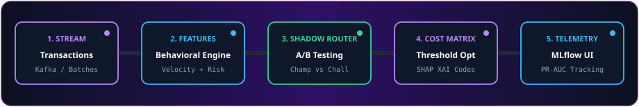
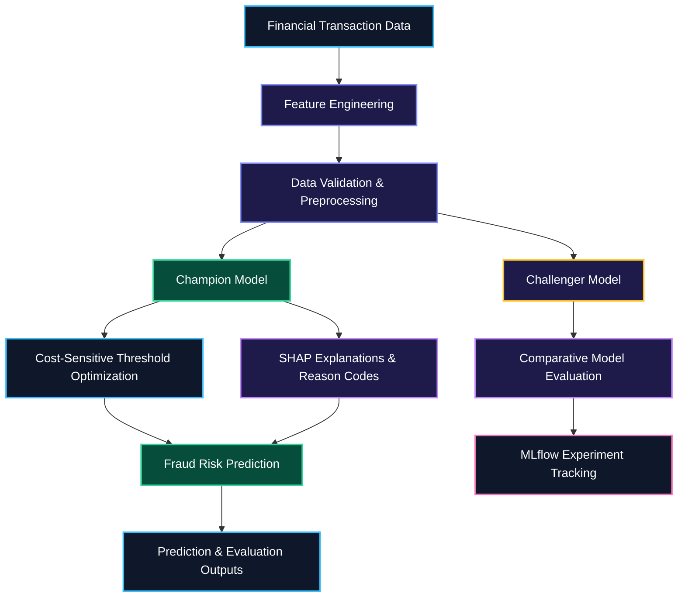

# 🕵️ FraudLens — Cost-Aware Financial Fraud Detection & MLOps

<div align="center">
  

  <br/><br/>

  
  
  
  
  
</div>

---

## 📌 Overview

**FraudLens** is a tabular machine learning and MLOps project designed to detect fraudulent financial transactions in highly imbalanced datasets.

Instead of relying solely on accuracy, it focuses on cost-sensitive decision-making, precision-recall evaluation, explainable predictions, and Champion-versus-Challenger model comparison.

The project brings together machine learning, financial risk analysis, model explainability, and experiment tracking in a unified workflow.

### 🎯 Project Objectives

- Detect potentially fraudulent transactions under severe class imbalance.
- Compare classification models using appropriate evaluation metrics.
- Optimize decision thresholds based on the financial cost of classification errors.
- Explain model predictions using SHAP feature attributions.
- Evaluate challenger models against a champion model.
- Track experiments, performance metrics, and model artifacts with MLflow.
- Support reproducible training, testing, and deployment workflows.

---

## 🏗️ End-to-End Pipeline & Architecture

<div align="center">
  
</div>

### System Architecture



The architecture separates data preparation, model training, threshold optimization, explainability, and evaluation. The actual implementation may use a different execution order or deployment design depending on the repository code.

---

## 🔧 Core Engineering Capabilities

### 1. Extreme Class Imbalance Optimization

Fraudulent transactions often represent only a small fraction of all transactions. Consequently, a model can achieve high accuracy while missing a substantial number of fraud cases.

FraudLens emphasizes:

- Precision-Recall AUC (PR-AUC).
- Fraud detection recall.
- Precision and false-positive analysis.
- Decision-threshold calibration.
- Comparison of candidate classification models.

### 2. Business Cost-Matrix Optimization

Fraud detection errors have different financial consequences.

- **False Negative (FN):** A fraudulent transaction is classified as legitimate.
- **False Positive (FP):** A legitimate transaction is incorrectly flagged as fraudulent.
- **True Positive (TP):** A fraudulent transaction is correctly identified.
- **True Negative (TN):** A legitimate transaction is correctly classified.

A cost-sensitive evaluation can estimate the expected loss:

\[
\text{Expected Cost} =
C_{FN}\cdot FN + C_{FP}\cdot FP
\]

Here, \(C_{FN}\) and \(C_{FP}\) represent the assigned costs of false negatives and false positives.

The threshold can then be selected to minimize the chosen cost function on validation data. The cost assumptions should reflect the intended business scenario rather than arbitrary values.

### 3. Champion-versus-Challenger Evaluation

A Champion-versus-Challenger workflow compares an established model with one or more candidate models.

The champion represents the current preferred model, while challenger models are evaluated for potential improvements in fraud detection performance, expected cost, and inference latency.

A true shadow deployment requires additional infrastructure to copy incoming requests to challenger models without allowing challenger predictions to affect customer-facing decisions.

If the repository currently performs offline model comparison only, describe it as Champion-versus-Challenger evaluation rather than claiming production shadow routing.

### 4. SHAP Explainability & Reason Codes

SHAP helps explain how individual input features contribute to a model prediction.

For fraud analysis, feature attributions can help reviewers investigate which transaction characteristics influenced the model's risk score.

These explanations are intended to support analysis and auditing. They do not independently prove that a transaction is fraudulent.

### 5. MLflow Experiment Tracking

MLflow supports reproducible experimentation by recording information such as:

- Model parameters and training configuration.
- Evaluation metrics.
- Experiment runs and comparisons.
- Model artifacts and associated metadata.

The exact logged fields depend on the training pipeline implementation.

---

## 📊 Evaluation Metrics

| Metric | Purpose |
|---|---|
| **PR-AUC** | Evaluates precision-recall performance under class imbalance. |
| **Recall@Fixed-FPR** | Measures the proportion of fraud detected at a specified false-positive rate. |
| **Precision** | Measures the proportion of flagged transactions that are actually fraudulent. |
| **Recall** | Measures the proportion of actual fraudulent transactions detected. |
| **F1-Score** | Balances precision and recall using their harmonic mean. |
| **Expected Cost** | Estimates the financial impact of false positives and false negatives. |
| **Inference Latency** | Measures the time required to produce predictions. |

### Why These Metrics Matter

- High recall helps reduce missed fraudulent transactions.
- High precision helps limit unnecessary declines or manual reviews.
- PR-AUC is useful when fraud cases are relatively rare.
- Expected cost connects model performance to business impact.
- Recall at a fixed false-positive rate evaluates fraud detection under an operational constraint.

The evaluation report should document the test split, fraud-class definition, cost assumptions, and threshold-selection procedure.

---

## 🧰 Technology Stack

| Component | Technology | Purpose |
|---|---|---|
| Programming Language | Python 3.11 | Core application and ML pipeline |
| Machine Learning | Scikit-learn | Preprocessing, classification, and evaluation |
| Gradient Boosting | XGBoost, if configured | Candidate fraud classifier |
| Anomaly Detection | Isolation Forest, if configured | Unsupervised anomaly scoring |
| Explainable AI | SHAP | Feature attribution |
| Experiment Tracking | MLflow | Experiment metrics and artifacts |
| API | FastAPI, if implemented | REST-based inference |
| Validation | Pydantic, if implemented | API input validation |
| Testing | Pytest | Automated tests |
| Containerization | Docker, if configured | Reproducible runtime |
| CI/CD | GitHub Actions, if configured | Automated validation |

*Keep the technology badges and stack entries aligned with the dependencies and features actually implemented in the repository.*

---

## 📂 Repository Structure

```text
FraudLens/
├── .github/
│   └── workflows/
│       └── ci.yml                 # GitHub Actions workflow, if configured
├── api/
│   └── main.py                    # API endpoints, if implemented
├── app/
│   └── dashboard.py               # Dashboard, if implemented
├── assets/
│   ├── fraud-banner.svg           # Animated repository banner
│   └── fraud-pipeline.svg         # Pipeline illustration
├── data/
│   └── raw/                       # Source or generated datasets
├── models/                        # Saved models and metadata
├── src/
│   ├── data/
│   │   └── generate_data.py       # Synthetic transaction generation
│   ├── models/
│   │   └── train.py               # Model training and evaluation
│   └── monitoring/
│       └── drift.py               # Optional model/data monitoring
├── tests/
│   └── test_api.py                # API tests, if implemented
├── Dockerfile                     # Optional container configuration
├── requirements.txt               # Python dependencies
├── .gitignore
└── README.md
```

*This is an illustrative project layout based on the supplied commands and architecture. Remove entries that do not exist in the actual repository, or update the structure to match the implementation.*

---

## 🚀 Quickstart & Local Execution

### Prerequisites

- Git
- Python 3.11
- pip
- A compatible operating system

### 1. Clone the Repository

```powershell
git clone https://github.com/Aditya70-creator/FraudLens.git
cd FraudLens
```

### 2. Create a Virtual Environment

**Windows PowerShell**

```powershell
python -m venv .venv
.\.venv\Scripts\Activate.ps1
```

**Linux / macOS**

```bash
python3 -m venv .venv
source .venv/bin/activate
```

If PowerShell blocks virtual environment activation, use the environment's Python executable directly:

```powershell
.\.venv\Scripts\python.exe -m pip install --upgrade pip
.\.venv\Scripts\python.exe -m pip install -r requirements.txt
```

### 3. Install Dependencies

If the virtual environment is activated:

```bash
python -m pip install --upgrade pip
pip install -r requirements.txt
```

### 4. Generate Synthetic Transaction Data

```bash
python -m src.data.generate_data
```

This step assumes the repository contains `src/data/generate_data.py` and that it generates the data files expected by the training pipeline.

### 5. Train and Evaluate Models

```bash
python -m src.models.train
```

The training script should prepare the data, train the configured models, evaluate their performance, and log experiment information where MLflow tracking is configured.

### 6. Run Automated Tests

```bash
pytest -v
```

Investigate any failing tests before treating the implementation as validated.

### 7. Start the FastAPI Server

If the repository implements `api/main.py` with a FastAPI application object named `app`, run:

```bash
uvicorn api.main:app --reload --host 127.0.0.1 --port 8000
```

Open Swagger UI:

http://127.0.0.1:8000/docs

If the repository does not contain this API module yet, use the actual entry point implemented in the project.

---

## 🐳 Docker Deployment

If the repository contains a working `Dockerfile`, build the image from the project root:

```powershell
docker build -t fraudlens .
```

Run the container:

```powershell
docker run --rm -p 8000:8000 fraudlens
```

For a FastAPI service, ensure the container starts the correct ASGI application and binds to `0.0.0.0` inside the container.

The Docker image must include the required dependencies and either the necessary model artifacts or a reliable model-loading process.

---

## 🔬 Reproducibility & Engineering Practices

FraudLens is designed around practical machine learning engineering principles:

- **Data leakage prevention:** Fit preprocessing transformations on training data only.
- **Validation-based threshold selection:** Tune thresholds on validation data rather than the final test set.
- **Cost transparency:** Document the assumed financial cost of each classification error.
- **Reproducibility:** Record relevant parameters, seeds, metrics, and model versions.
- **Model consistency:** Apply the same preprocessing transformations during training and inference.
- **Automated testing:** Test input validation, model behavior, and important edge cases.
- **Experiment tracking:** Keep benchmark results connected to their corresponding training runs.
- **Security:** Avoid committing sensitive transaction data, credentials, or secrets.

---

## 🗺️ Engineering Roadmap

The following checklist describes the intended development milestones. Mark each item complete only after confirming that the implementation exists and works.

- [ ] Transaction dataset preparation and validation
- [ ] Synthetic fraud-data generation, if applicable
- [ ] Leak-free preprocessing pipeline
- [ ] Baseline model training and evaluation
- [ ] Class imbalance handling
- [ ] Precision-recall threshold calibration
- [ ] Business cost-matrix optimization
- [ ] Champion-versus-Challenger model comparison
- [ ] SHAP-based prediction explanations
- [ ] MLflow experiment tracking
- [ ] FastAPI inference service, if included
- [ ] Automated Pytest suite
- [ ] GitHub Actions CI workflow
- [ ] Dockerized deployment, if included
- [ ] Documented benchmark results and reproducible evaluation

---

## 🔐 Security & Responsible Use

FraudLens is intended for educational, research, and defensive financial-risk applications.

- Use authorized datasets and protect sensitive transaction information.
- Never expose payment credentials or personal financial data in logs.
- Treat predictions as risk indicators rather than definitive proof of fraud.
- Evaluate false positives and false negatives before operational use.
- Document threshold and cost assumptions.
- Apply appropriate access controls and monitoring before deploying a fraud detection service.

---

## 🤝 Contributing

Contributions, bug reports, and improvement suggestions are welcome.

1. Fork the repository.
2. Create a feature branch.
3. Make your changes.
4. Run the relevant tests.
5. Submit a pull request with a clear description.

Include tests when changing model behavior, evaluation logic, or API contracts.

## 📄 License

This project uses the MIT License if a valid MIT `LICENSE` file is included in the repository.

See [`LICENSE`](./LICENSE) for the license terms.

## 👨‍💻 Author

**Aditya Mitra**

- GitHub: [@Aditya70-creator](https://github.com/Aditya70-creator)
- Repository: [FraudLens](https://github.com/Aditya70-creator/FraudLens)

---

<div align="center">
  <b>Building cost-aware, explainable, and reproducible fraud detection systems.</b>
</div>
