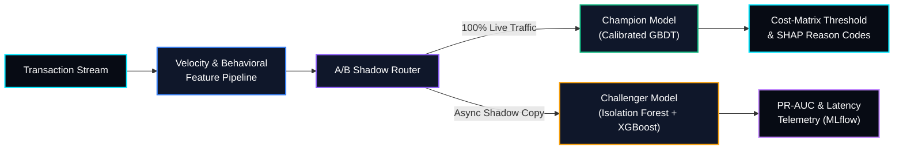

# 💳 FraudLens — Financial Anomaly Detection & A/B Shadow Engine


> **FraudLens** is a tabular Machine Learning and MLOps platform designed for highly imbalanced financial transaction fraud detection. It focuses on cost-sensitive decision thresholding, explainable fraud predictions, and Champion-versus-Challenger shadow model evaluation.

---

## 🏗️ System Architecture



## 🎯 Project Objectives

- Detect fraudulent transactions under severe class imbalance.
- Minimize financial losses through cost-sensitive classification thresholds.
- Compare production and candidate models using shadow evaluation.
- Generate explainable fraud predictions using SHAP.
- Track model performance and inference latency using MLflow.

## 🔧 Core ML & MLOps Engineering

### 1. Extreme Class Imbalance

Fraudulent transactions may represent less than 0.5% of the dataset. Model evaluation prioritizes **Precision-Recall AUC (PR-AUC)** and **Recall at a Fixed False Positive Rate (FPR)** instead of relying exclusively on ROC-AUC.

### 2. Business Cost-Matrix Optimization

Classification thresholds are selected according to the relative costs of missed fraud and legitimate transactions being incorrectly declined.

\[
\text{Total Cost} =
(C_{\text{FN}} \times N_{\text{FN}})
+
(C_{\text{FP}} \times N_{\text{FP}})
\]

Where:

- \(C_{\text{FN}}\): Cost of a missed fraudulent transaction.
- \(N_{\text{FN}}\): Number of fraudulent transactions incorrectly classified as legitimate.
- \(C_{\text{FP}}\): Cost of incorrectly declining a legitimate transaction.
- \(N_{\text{FP}}\): Number of legitimate transactions incorrectly classified as fraudulent.

### 3. Champion–Challenger Shadow Deployment

The Champion model handles live predictions, while the Challenger receives a shadow copy of eligible requests for evaluation. Challenger predictions are not used for customer-facing decisions during shadow evaluation.

### 4. Explainable Fraud Predictions

SHAP values help identify the features contributing to individual predictions and support human-readable fraud-review reason codes.

### 5. Model Monitoring

MLflow tracks model versions, evaluation metrics, and experiment results. Prediction latency and model-quality metrics are monitored to help identify regressions.

## 🧰 Technology Stack

- **Language:** Python
- **Machine Learning:** Scikit-learn, Gradient Boosting, Isolation Forest
- **Explainability:** SHAP
- **Experiment Tracking:** MLflow
- **Streaming / Event Processing:** Apache Kafka
- **Evaluation:** PR-AUC, Recall@Fixed-FPR, confusion matrix, financial cost analysis

## 📂 Repository Structure

```text
FraudLens/
├── src/
│   ├── features/
│   │   └── transaction_features.py
│   ├── training/
│   │   └── train_model.py
│   ├── evaluation/
│   │   └── cost_optimizer.py
│   └── router/
│       └── shadow_router.py
├── notebooks/
│   └── fraud_detection_eda.ipynb
├── tests/
├── requirements.txt
└── README.md
```

*The filenames above represent a suggested project structure; adjust them to match the files actually present in the repository.*

## 🗺️ Engineering Roadmap

- [x] Architecture blueprint and cost-sensitive evaluation design
- [x] Baseline-versus-GBDT PR-AUC benchmarking
- [ ] Probability calibration using Platt scaling or isotonic regression
- [ ] Champion–Challenger shadow router implementation
- [ ] MLflow experiment tracking and model registry integration
- [ ] SHAP-based reason-code generation
- [ ] Automated model-quality and latency monitoring
- [ ] Unit tests and reproducible evaluation pipeline

## 📊 Evaluation Metrics

| Metric | Purpose |
|---|---|
| PR-AUC | Evaluate fraud detection under class imbalance |
| Recall@Fixed-FPR | Measure fraud detection at a controlled false-positive rate |
| Precision | Measure the proportion of flagged transactions that are fraudulent |
| False Positive Rate | Track legitimate transactions incorrectly flagged |
| Expected Financial Cost | Quantify the business impact of classification errors |
| Inference Latency | Measure prediction response time |

## ⚠️ Project Status

FraudLens is under active development. Completed milestones should reflect implemented and reproducibly tested functionality, not architecture plans alone.

For reproducible experiments, document the dataset source, train/test split strategy, random seed, baseline metrics, and model evaluation configuration.

---

*FraudLens — Building explainable, cost-aware fraud detection systems with MLOps.*
